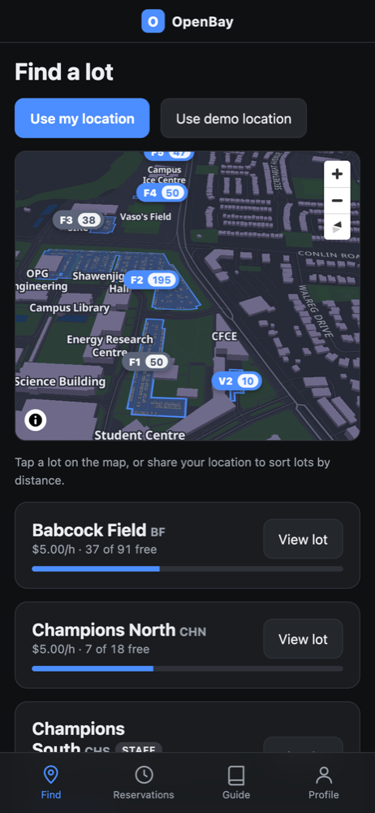
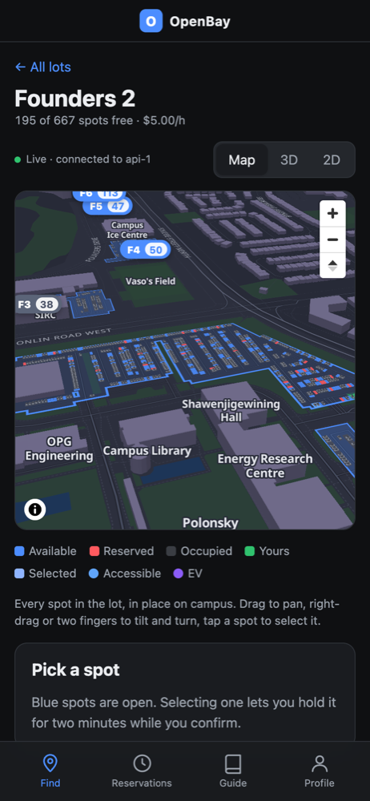
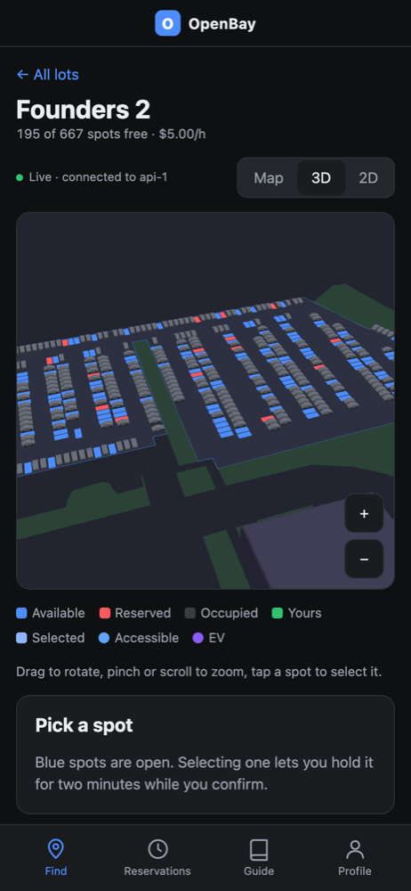
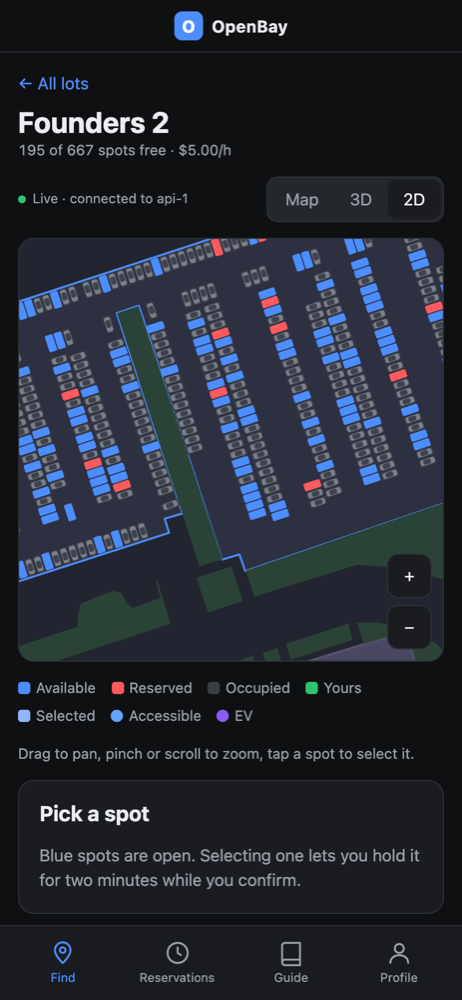
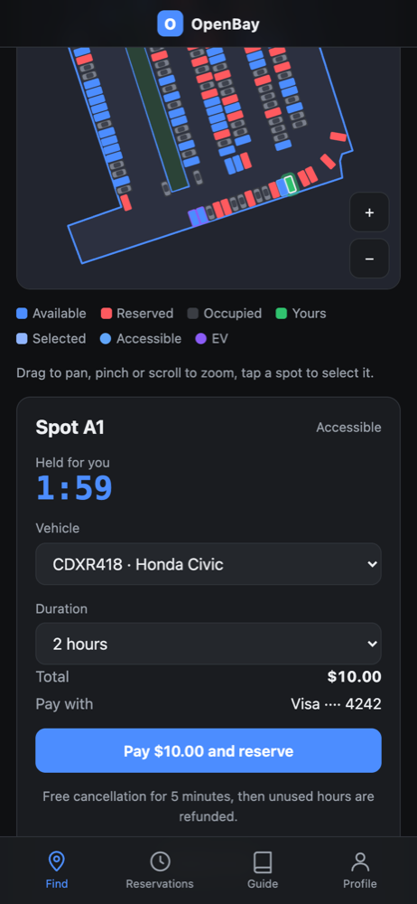
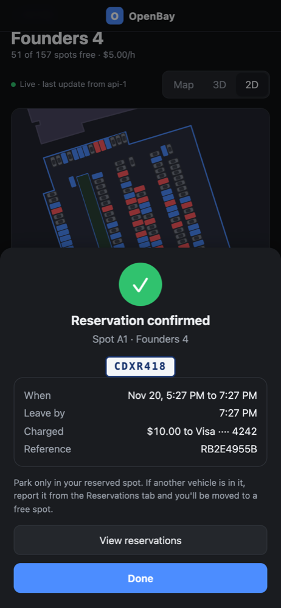
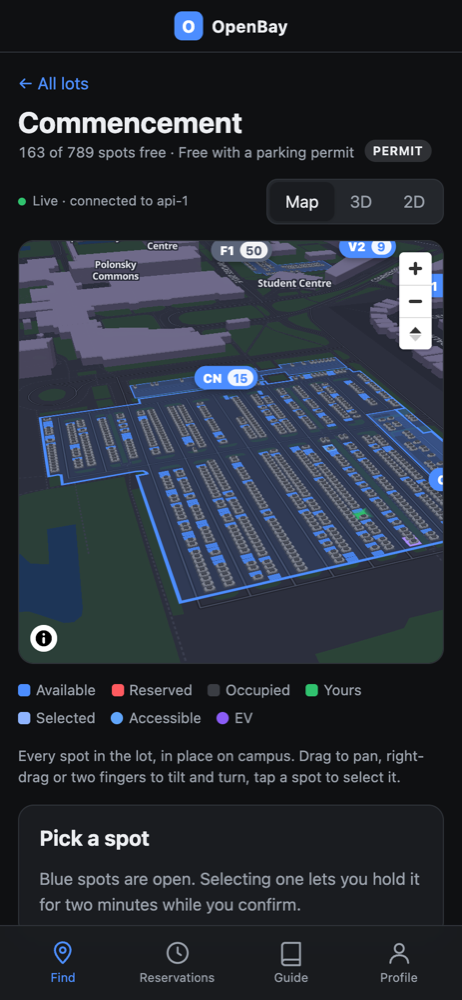
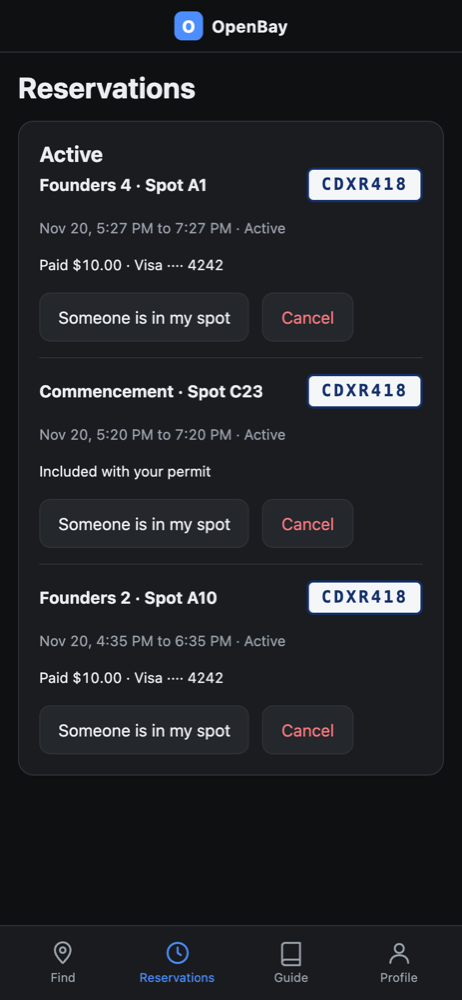
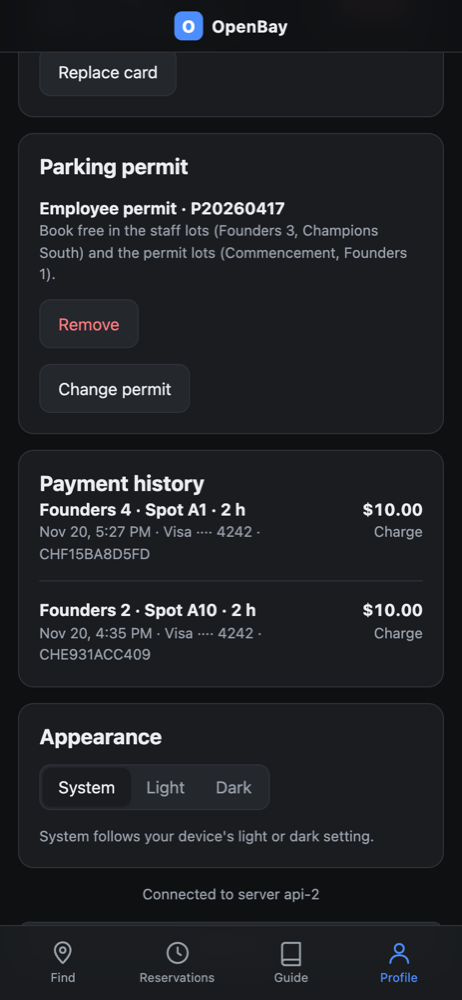
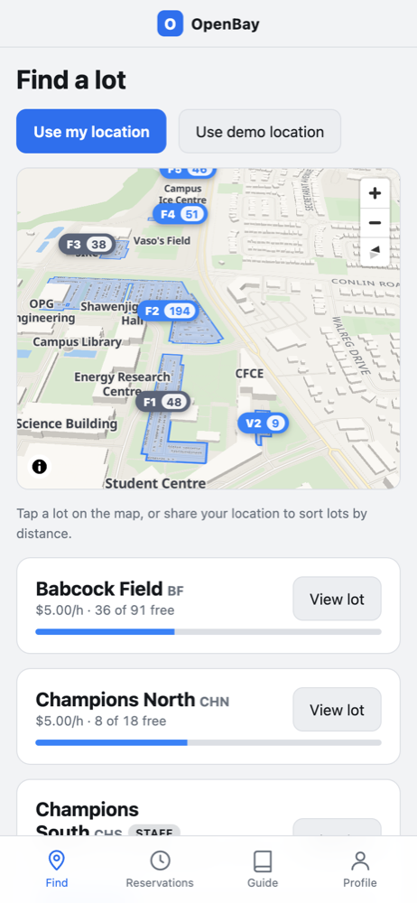

# OpenBay: distributed smart parking reservations

SOFE4790U Distributed Systems, Fall 2026.

OpenBay is a parking reservation app for Ontario Tech University's north Oshawa campus. Drivers
find a lot on a 3D map of the campus, see every spot live, hold one for two minutes, pay, and
reserve it. If someone else is parked in their spot, they report it and are moved to the closest
free spot automatically. Behind the app, two identical API replicas share PostgreSQL and Redis
behind an nginx load balancer, so any replica can serve any request and one can fail without
the app going down.

<table>
  <tr>
    <td align="center"><br><sub><b>Find a lot</b>: 3D campus map with live free-spot counts</sub></td>
    <td align="center"><br><sub><b>Lot map</b>: every spot and parked car, in place on campus</sub></td>
    <td align="center"><br><sub><b>3D view</b>: the lot's real layout, rotate and zoom</sub></td>
  </tr>
  <tr>
    <td align="center"><br><sub><b>2D plan</b>: top-down, north up, tap to select</sub></td>
    <td align="center"><br><sub><b>Hold and pay</b>: two-minute hold, your spot in green</sub></td>
    <td align="center"><br><sub><b>Confirmed</b>: charged to the saved card</sub></td>
  </tr>
  <tr>
    <td align="center"><br><sub><b>Permit lots</b>: free with the right permit</sub></td>
    <td align="center"><br><sub><b>Reservations</b>: cancel, refund, or report a car in your spot</sub></td>
    <td align="center"><br><sub><b>Profile</b>: permit, card, payment history</sub></td>
  </tr>
</table>

<p align="center"><br><sub>Light mode follows the device setting, or pick it in Profile.</sub></p>

## Features

- **3D campus map.** The Find screen opens on a tilted 3D map of the campus: real streets and
  buildings from OpenStreetMap, landmark names (Campus Library, Science Building, SIRC and more),
  and every lot drawn from its real outline. Each lot has a pin with its live free-spot count and
  turns red when full. Parked cars show up as small 3D cars in every lot. Tap a pin to open the lot.
- **Real lot layouts.** Spots are laid out the way each lot is really painted: along both sides
  of the lot's driving aisles (traced from aerial photos by OpenStreetMap mappers), at real size,
  clear of grass islands and buildings. About 2,800 spots across 15 lots, 667 of them in Founders 2.
- **Three ways to see a lot.** **Map** shows the lot in place on campus, **3D** is an orbitable
  model of the lot with its buildings and grass islands, and **2D** is a top-down plan. All three
  draw the same layout, north up, update live, and let you tap a spot to select it. Your spot
  glows green.
- **Hold, pay, reserve.** Holding a spot locks it for two minutes while you confirm. Paying uses a
  pretend card processor with test cards, including declines. Cancel within 5 minutes for a full
  refund; after that, the unused whole hours are refunded.
- **Permit lots.** Commencement and Founders 1 are for campus parking permit holders, and Founders
  3 and Champions South for employee permit holders (an employee permit also opens the permit
  lots). Add a permit in Profile and booking there is free. Without the right permit, the app
  explains why and the server refuses the hold.
- **Someone in my spot.** Report it from Reservations and you're moved to the nearest free spot
  you're allowed to use: same lot first, then the nearest other lot. If nothing is free anywhere,
  the booking is cancelled and refunded.
- **Find by GPS.** Share your location (or use the demo location) to sort lots by distance and
  detect the lot you're standing in.
- **Light and dark mode**, phone-first layout, and a Guide tab explaining how it all works.

## Run it

You need Docker Desktop.

```bash
docker compose up --build
```

Open <http://localhost:8080> and tap **Use demo account**, or create an account.

To stop: `Ctrl+C`, then `docker compose down`. Add `-v` to also delete the database.

### Test cards

Payments go through a pretend card processor (`backend/app/payments.py`), so no real money moves.
Use any future expiry.

| Card number | What happens |
| --- | --- |
| `4242 4242 4242 4242` | Approved |
| `4000 0000 0000 0002` | Declined |
| `4000 0000 0000 9995` | Declined: insufficient funds |

Charges, declines and refunds show under **Profile → Payment history**.

### Permits

Add one under **Profile → Parking permit**. In the demo any permit number is accepted (a real
build would check it with Parking Services). Pick **Parking permit** for Commencement and
Founders 1, or **Employee permit** for those plus Founders 3 and Champions South.

### Without Docker (one process, for quick UI work)

```bash
cd backend
python3.12 -m venv .venv && source .venv/bin/activate
pip install -r requirements-dev.txt
DATABASE_URL=sqlite+aiosqlite:///./openbay.db REDIS_URL=fake:// FRONTEND_DIR=../frontend uvicorn app.main:app --reload
```

Open <http://localhost:8000>. This runs one replica with SQLite and an in-memory Redis, so it shows
the app but not the distributed parts. It needs Python 3.12 or newer.

### On a phone

Open `http://<your laptop's IP>:8080` on a phone on the same Wi-Fi. Browsers only allow GPS on
HTTPS or `localhost`, so on a phone use **Use demo location**, or put the site behind an HTTPS
tunnel (for example `cloudflared tunnel --url http://localhost:8080`).

## The lots

| Lot | Who can book | Spots |
| --- | --- | --- |
| Founders 2, 4, 5, 6 | Anyone, $5/h | 667, 157, 169, 272 |
| Commencement North, Commencement South | Anyone, $5/h | 44, 92 |
| Babcock Field, Simcoe Village | Anyone, $5/h | 91, 55 |
| Visitor Lot 1, Visitor Lot 2, Champions North | Anyone, $5/h | 31, 28, 18 |
| Commencement, Founders 1 | Parking or employee permit, free | 789, 209 |
| Founders 3, Champions South | Employee permit, free | 119, 72 |

Lot names and which lots sell daily parking come from the university's North Campus Parking Map.
Outlines, driving aisles, grass islands and buildings come from OpenStreetMap
(`backend/app/data/campus.json`). $5 an hour is the university's weekday daily rate.

`backend/app/layout.py` places the spots: along both sides of every mapped aisle, nose-in, at
2.7 × 5.4 m. A spot is kept only if it sits wholly inside the lot, clear of islands, buildings
and other aisles, and doesn't overlap another spot (in its own lot or a neighbouring one). Founders
6 and Champions North have no mapped aisles, so they get plain rows. The database, the map, and the
2D and 3D views all use this one layout, so they always agree.

Each start brings an existing database up to date: new lots and spots are added, and spots no
longer in the layout are removed (or, if someone booked them, kept for history and taken out of
service). Accounts and reservations are kept.

## Architecture

```
                 ┌──────────────┐
  browser  ────► │  nginx (web) │  serves the app, load-balances /api and /ws
  simulator ───► └──────┬───────┘
                 ┌──────┴───────┐
                 ▼              ▼
             ┌───────┐      ┌───────┐   identical, stateless FastAPI replicas
             │ api-1 │      │ api-2 │
             └───┬───┘      └───┬───┘
        ┌────────┴──────┬───────┴────────┐
        ▼               ▼                ▼
  ┌────────────┐  ┌───────────────────────────────┐
  │ PostgreSQL │  │ Redis                         │
  │ records    │  │ spot holds (locks with a TTL) │
  └────────────┘  │ pub/sub for live updates      │
                  └───────────────────────────────┘
```

| Service | What it does |
| --- | --- |
| `web` | nginx. Serves `frontend/` and spreads API and WebSocket traffic across the replicas (`least_conn`). If a replica stops answering, requests go to the other one. |
| `api-1`, `api-2` | The FastAPI backend (`backend/app`). They keep nothing in memory that matters, so any replica can serve any request. Each response carries `X-Served-By` so you can see which one answered. |
| `db` | PostgreSQL 16: users, vehicles, cards, permits, lots, spots, reservations, payments, violation reports. |
| `redis` | Redis 7: two-minute spot holds, and the channel that carries live spot changes between replicas. |
| `simulator` | Stands in for the real world: parking sensors report cars arriving and leaving, and six bot drivers hold, reserve and cancel spots through the normal API. |

The web app is plain HTML, CSS and JavaScript modules with no build step. The 3D campus map uses
[MapLibre GL](https://maplibre.org) with free [OpenFreeMap](https://openfreemap.org) tiles (no API
key), and the 3D lot view uses [three.js](https://threejs.org). Both load from a CDN, so the maps
need an internet connection. Without one, or without WebGL, the app falls back to a flat map and
the 2D plan.

### Distributed systems ideas it uses

- **Stateless replicas behind a load balancer.** Sessions are signed JWTs, so no replica needs to
  remember a login. Stop one (`docker compose stop api-2`) and the app keeps working.
- **Distributed lock with a lease.** Holding a spot is a Redis key with a 120 second TTL
  (`backend/app/locks.py`). Taking and releasing it runs as a Lua script, which Redis executes
  atomically, so two drivers on different replicas can never both hold one spot. If a driver
  walks away, the lease simply expires.
- **Defence in depth against double booking.** Under the Redis lock, PostgreSQL has a partial
  unique index allowing only one *active* reservation per spot (`models.py`). Even if the lock
  failed, the database would reject the second booking.
- **Idempotent payments.** The app sends a fresh `payment_key` with each attempt to pay. If a
  request is retried (a double tap, or nginx resending it after a replica fails), the server
  answers with the first result instead of charging again. The reservation and its payment are
  saved in one transaction, and a charge whose booking loses a race is refunded at once.
- **Publish/subscribe fan-out.** Every replica subscribes to `lot:*` in Redis. When any replica
  changes a spot it publishes once, and every replica pushes the change over WebSockets to the
  apps connected to it (`events.py`). The lot screen shows which replica the last update came from.
- **Coordinated startup.** All replicas start together; a Redis lock lets exactly one create the
  tables and seed or update the lots (`main.py`).
- **Idempotent background work.** Each replica periodically marks finished reservations as
  completed. Running it on both is safe because the update only matches rows once.
- **Reconnection.** If the WebSocket drops (say a replica restarts), the app reconnects with
  backoff and nginx sends it to a healthy replica.

### What happens when you reserve

1. **Hold:** `POST /api/lots/F2/spots/B6/hold`. The replica checks the driver may use the lot
   (permit lots), that the spot isn't occupied or reserved, then runs the Redis Lua script. Only
   one caller gets the lock; the rest get 409. The change is published, and every open app turns
   the spot red.
2. **Confirm and pay:** `POST /api/reservations`. The replica checks that this driver still holds
   the lock and charges the card (nothing to charge in a permit lot). A declined card returns 402
   and the hold stays, so the driver can switch cards. Otherwise it inserts the reservation and its
   payment in one transaction (the unique index guards it again), releases the lock and publishes
   the change.
3. **Violation:** `POST /api/reservations/{id}/violations`. The blocked spot is marked occupied.
   Candidates are ranked: same lot and same kind of spot, nearest first; then same lot standard
   spots; then the nearest other lot the driver may use. Each candidate is locked in Redis before
   the reservation moves, so a concurrent driver can't take it mid-move. If nothing is free, the
   reservation is cancelled and refunded.

## Testing

```bash
cd backend && pip install -r requirements-dev.txt && pytest
```

29 tests cover accounts, validation, holds, reservations, payments (charges, declines, refunds,
idempotent retries), permit lots, cancelling, the database's double-booking guard, violation
reassignment (including to another lot), the spot layout (inside the lot, no overlaps within or
between lots, rows following the real aisles), sensor events and live updates. They use SQLite
and an in-memory Redis, so they need no services.

**Race test.** With the stack running:

```bash
python scripts/race_test.py http://localhost:8080 200
```

200 drivers try to hold one spot (in Founders 2) at the same instant. Output from an earlier run
with two replicas, before the real lots were added (lot IDs were `L1` to `L4` then):

```
200 drivers racing for spot L3/A3 through http://localhost:8080
  hold results: {200: 1, 409: 199} in 974 ms
  requests per replica: {'api-1': 100, 'api-2': 100}
  reservations by drivers without the hold: 0
PASS: exactly one driver got the spot
```

**Failover demo.** Open a lot in the browser, then run `docker compose stop api-2`. Spots keep
updating and new requests are answered by `api-1`. `docker compose start api-2` brings it back.

## API

Interactive docs with a "Try it out" button: <http://localhost:8080/api/docs>.

| Method | Path | What it does |
| --- | --- | --- |
| POST | `/api/auth/register` | Create an account (optionally with a vehicle and card). Returns a token. |
| POST | `/api/auth/login` | Sign in. Returns a token. |
| GET, PATCH | `/api/me` | Read or update name and phone. |
| POST, DELETE | `/api/me/vehicles[/{id}]` | Add or remove a vehicle. |
| PUT, DELETE | `/api/me/card` | Save or remove the payment card's display details. |
| PUT, DELETE | `/api/me/permit` | Save or remove a parking or employee permit. |
| GET | `/api/lots` | Lots with free counts and who can book them. |
| GET | `/api/lots/{lot}/spots` | Every spot with its live status. |
| GET | `/api/lots/map` | Every lot's outline and bays, grass islands, buildings and landmarks, for the maps. |
| GET | `/api/lots/{lot}/map` | Where each spot in a lot sits on the ground. |
| GET | `/api/lots/parked` | Which spots have a car in them, for every lot. |
| POST, DELETE | `/api/lots/{lot}/spots/{spot}/hold` | Take or release a two-minute hold. |
| GET, POST | `/api/reservations` | List mine, or pay for a hold and turn it into a reservation. |
| DELETE | `/api/reservations/{id}` | Cancel and refund. |
| GET | `/api/payments` | My charges, declines and refunds. |
| POST | `/api/reservations/{id}/violations` | Report a vehicle in my spot and get moved. |
| GET | `/api/violations` | My reports. |
| POST | `/api/sensors/events` | Sensor reports a car arriving or leaving (needs `X-Sensor-Key`). |
| WS | `/ws/lots/{lot}?token=…` | Live spot changes for one lot. |
| GET | `/api/health` | Which replica answered, and whether Redis is reachable. |

## Project layout

```
docker-compose.yml        the whole system
nginx/nginx.conf          load balancer and static files
backend/
  app/main.py             app setup, startup lock, sweeper
  app/models.py           database tables
  app/locks.py            Redis spot holds (Lua scripts)
  app/layout.py           lays spots along each lot's real aisles; who may use which lot
  app/data/campus.json    lot outlines, aisles, islands, buildings, landmarks (OpenStreetMap)
  app/payments.py         pretend card processor and refund rules
  app/seed.py             creates and updates the lots and spots
  app/spots.py            spot status, publishing changes
  app/events.py           WebSocket fan-out from Redis pub/sub
  app/routers/            one file per area of the API
  sim/                    sensor and bot-driver simulator
  tests/                  pytest suite
frontend/
  index.html              page shell
  css/styles.css          all styling, light and dark themes
  js/main.js              routing and event handling
  js/api.js               every call to the server, WebSocket reconnects
  js/campusmap.js         the 3D campus map and a lot's Map view (MapLibre + OpenFreeMap)
  js/lotplan.js           a lot's layout in local metres, for the 2D and 3D views
  js/lot3d.js             the 3D lot view (three.js)
  js/plan2d.js            the 2D plan of a lot
  js/views/               one file per screen
docs/screenshots/         the pictures in this README
scripts/race_test.py      concurrency test
```

## Not production-ready

- **Payments are simulated.** Only the card brand, last four digits and expiry reach the server,
  and `app/payments.py` stands in for the processor. A real build would use a payment provider's
  hosted form, store its token, and call the provider in `charge()` and `refund()`.
- **Permits aren't verified.** Any permit number is accepted. A real build would check it with
  Parking Services.
- **Schema changes.** Tables are created at startup. Use Alembic migrations before changing
  models on a database with real data.
- **Auth hardening.** No login rate limiting, refresh tokens or email verification. Set a long
  random `JWT_SECRET` (see `.env.example`) before deploying anywhere.
- **Single Redis and Postgres.** The API tier is replicated; the data tier is not. Redis Sentinel
  and a Postgres replica would remove those single points of failure.
- **Lot data.** Lot names, outlines and aisles are real. Spots are placed by rule along the
  aisles, not surveyed one by one, so counts are close to the real ones but not exact. Angled
  parking is drawn straight-in, and accessible and EV spots are placed by a rule. Founders 6 and
  Commencement South are outlined from the campus map because OpenStreetMap has no outline for
  them. The $20 daily maximum and the evening and weekend flat rates are not modelled.
- **The iOS app** (`OpenBay-iOS`) still uses its own on-device mock. Its `AppStore` methods are
  named after these routes, so pointing it at this API means replacing those method bodies with
  `URLSession` calls.

Map data © [OpenStreetMap](https://www.openstreetmap.org/copyright) contributors (ODbL). Map tiles
by [OpenFreeMap](https://openfreemap.org) and [OpenMapTiles](https://openmaptiles.org).
